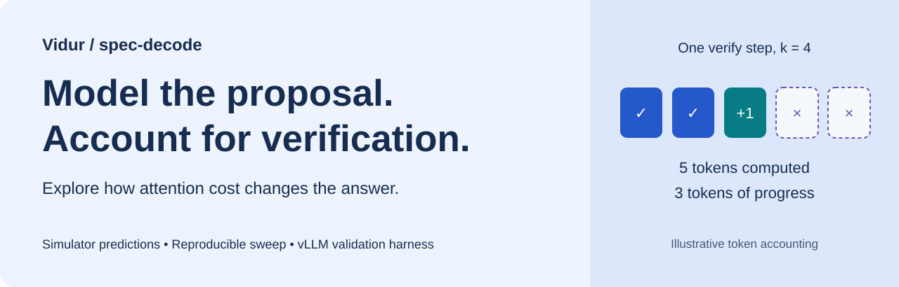
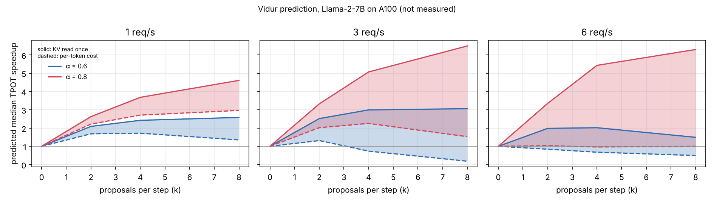

<p align="center"></p>

# Vidur: speculative decoding

**This fork adds speculative decoding** to [Microsoft Vidur](https://github.com/microsoft/vidur), an LLM inference system simulator. It models proposal generation, target-model verification, accepted-token progress, and lookahead KV memory, with a harness for comparison against real vLLM runs.

[**Explore the interactive results**](https://asp53826.github.io/vidur/) · [Design & assumptions](docs/speculative_decoding.md) · [Validation workflow](validation/README.md) · [Recorded results (CSV)](docs/assets/spec_decode_sweep/results.csv)

## The result worth inspecting

**The attention-cost assumption can change whether speculative decoding looks beneficial.** For Llama-2-7B on the bundled A100 profile at 3 requests/s, four proposals, and acceptance rate 0.6:

| Verify-attention assumption | Predicted median TPOT | Speedup vs. baseline |
| --- | ---: | ---: |
| No speculation | 21.59 ms | 1.00× |
| KV read once (`decode_shared_kv`) | 7.22 ms | 2.99× |
| Per-token cost (`decode_per_token`) | 29.32 ms | 0.74× |

These are **simulator predictions, not measured GPU speedups**. The [39-row sweep](docs/assets/spec_decode_sweep/results.csv) covers three loads, three proposal counts, two acceptance rates, and two attention-cost assumptions, plus a baseline at each load. At 6 requests/s, the baseline is overloaded; those ratios depend on run length. GPU validation remains to be run.

[](https://asp53826.github.io/vidur/)

## What this extension adds

| Component | Implementation |
| --- | --- |
| Acceptance and progress | A verify step computes `k + 1` tokens but advances by `accepted + 1`. Supports constant, position-dependent, and per-request acceptance, plus steps without proposals. |
| Scheduling and memory | Sarathi token-budget trimming, proposal limits at request boundaries, lookahead KV allocation, and draft-model weights/KV accounting. |
| Cost modeling | N-gram/fixed proposer overhead or an independent draft-model predictor; lower, upper, and interpolated verify-attention cost models. |
| Evaluation | Per-request speculative metrics, vLLM counter calibration, matched-workload replay, and measured-vs-simulated reports. |

Speculation is **off by default**. The supplied [upstream comparison script](scripts/check_matches_upstream.sh) checks request metrics against upstream commit `abae7f6`. One deliberate behavior change is linear extrapolation of decode-attention lookups beyond the profiled batch size, where upstream raised `KeyError`.

## Run it

Use Python 3.10 or newer; the publication checks use Python 3.11. From the repository root:

```bash
git clone --branch spec-decode https://github.com/asp53826/vidur.git
cd vidur
python3 -m venv .venv
source .venv/bin/activate
python -m pip install -r requirements.txt
export WANDB_MODE=disabled

python -m vidur.main \
  --replica_config_device a100 \
  --replica_config_model_name meta-llama/Llama-2-7b-hf \
  --replica_scheduler_config_type sarathi \
  --replica_config_num_pipeline_stages 1 \
  --speculative_decoding_config_num_speculative_tokens 4 \
  --speculative_decoding_config_acceptance_rate 0.6
```

The first simulation trains timing predictors from the bundled profiles and can take several minutes. Add the usual model, workload, and scheduler flags for your experiment; see the [upstream usage guide](docs/upstream-readme.md#running-the-simulator).

### Inspect the output

Simulation runs are written under `simulator_output/<TIMESTAMP>/`:

- `request_metrics.csv`: request latency and token metrics.
- `speculative_decoding_metrics.csv`: speculative accounting per request.
- `speculative_decoding_summary.json`: aggregate acceptance and proposal metrics.

The [project page](https://asp53826.github.io/vidur/) explores the bundled sweep. Its controls select existing results; they do not run a new simulation in your browser.

### Reproduce and validate

```bash
# Reproduce the recorded simulator sweep (CPU; trains predictors if needed).
python scripts/spec_decode_sweep.py --out-dir docs/assets/spec_decode_sweep

# Run unit and fake-server harness tests without a GPU.
python -m pip install pytest aiohttp
python -m pytest tests validation/tests

# Compare default-off request metrics with upstream (trains predictors).
bash scripts/check_matches_upstream.sh
```

The optional end-to-end harness test requires a populated predictor cache: `VIDUR_CACHE_DIR=cache python -m pytest validation/tests`. For real GPU experiments, use the [Sapelo2/vLLM validation workflow](validation/README.md).

## Scope and limitations

- Speculative scheduling supports **Sarathi with pipeline parallelism 1**.
- Acceptance is an input calibrated from vLLM counters, not a predicted property of a model pair.
- Verify attention is bracketed using existing decode profiles; it has not been profiled directly for this setup.
- A step proposes `k` tokens or none. Short drafts, rejection-sampler overhead, and draft pass 1 remain approximations.
- The bundled profiles predate current vLLM kernels. Baseline error must be measured before interpreting speculative accuracy.

See [the complete modeling notes](docs/speculative_decoding.md#known-limitations) before using these predictions for capacity planning.

## Project map

| Path | Purpose |
| --- | --- |
| [`vidur/entities/speculative_decoding.py`](vidur/entities/speculative_decoding.py) | Acceptance model and token accounting |
| [`tests/`](tests/) | Acceptance, scheduler, and predictor tests |
| [`scripts/spec_decode_sweep.py`](scripts/spec_decode_sweep.py) | Reproducible simulator sweep |
| [`validation/`](validation/) | vLLM measurement and calibration harness |
| [`docs/project/`](docs/project/) | Interactive GitHub Pages presentation |
| [`docs/upstream-readme.md`](docs/upstream-readme.md) | Original Vidur setup, supported models, and usage |

## Acknowledgments and license

This is an independent extension of **Microsoft Vidur**, originally developed by the MSR-India Systems Group and the Systems for AI Lab at Georgia Tech. It is not an official Microsoft release or endorsement. The original [MLSys 2024 paper](https://arxiv.org/abs/2405.05465), [profiling guide](docs/profiling.md), and [metrics reference](docs/metrics.md) describe the underlying simulator.

The original [MIT license](LICENSE), [Code of Conduct](CODE_OF_CONDUCT.md), and upstream contribution policies apply. See the [preserved upstream README](docs/upstream-readme.md#contributing) for contributor and trademark guidance.
